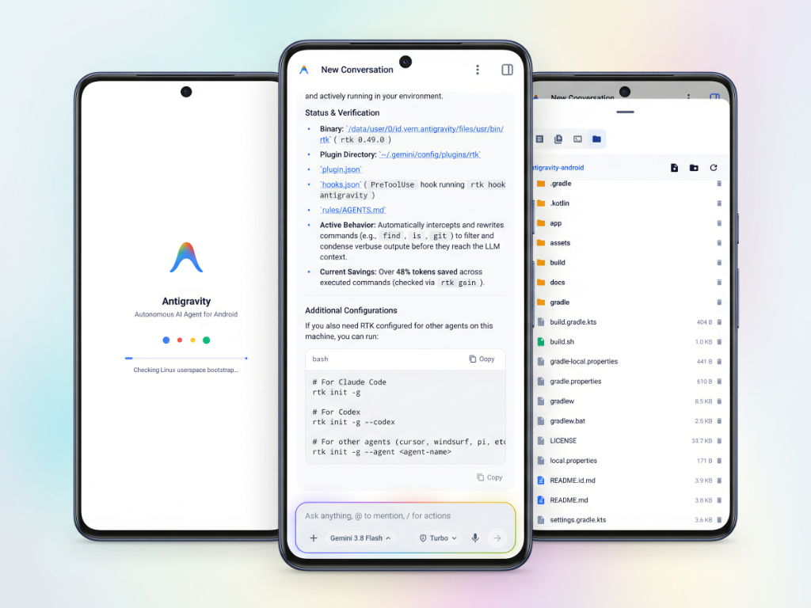

  

  # Antigravity for Android

  

    
    &nbsp;
    
  

  
  
  
  
  

    

  

Antigravity for Android adalah aplikasi untuk menjalankan Google Antigravity AI coding agent langsung di HP Android. Aplikasi ini menyediakan userspace Linux ARM64 lokal dengan UI Jetpack Compose, sehingga agent bisa langsung akses workspace project, edit code, dan eksekusi command terminal (`git`, `bash`, `python`, `pkg`) langsung dari HP tanpa butuh PC.

## Fitur

- **UI Jetpack Compose**: Tampilan chat dan code editor ringan untuk layar HP.
- **Userspace Linux Lokal**: Environment ARM64 dengan `bash`, `python3`, dan CLI tools.
- **Engine Resmi Antigravity**: Menjalankan binary `language_server` resmi via login Google OAuth 2.0 PKCE.
- **Package Manager `pkg`**: Package manager bawaan (Bash & AWK) untuk install tools langsung di terminal.
- **Background Daemon (`agy-daemon`)**: Service background untuk cron task, file watcher, dan notifikasi status bar.
- **Skills & Plugins**: Mengambil skills dan plugins komunitas langsung dari katalog.

## Repo Terkait

- [KuatoDev/antigravity-bootstrap](https://github.com/KuatoDev/antigravity-bootstrap) — Rootfs Linux ARM64 yang diekstrak saat pertama kali aplikasi dibuka.
- [KuatoDev/antigravity-catalogue](https://github.com/KuatoDev/antigravity-catalogue) — Katalog skills dan plugins. Submit pull request ke sini jika ingin menambahkan skill buatan sendiri :)

## Persyaratan

- Android 11 ke atas (`arm64-v8a`)
- Izin akses storage & notifikasi

## Komunitas

- **Channel Telegram**: [t.me/vernkuato](https://t.me/vernkuato)
- **Grup Telegram**: [t.me/kuatodevprojects](https://t.me/kuatodevprojects)

## Donasi

Jika Antigravity for Android bermanfaat untuk Anda dan ingin mendukung pengembangannya, Anda dapat berdonasi melalui:

  

   

  
  &nbsp;
  

  
Scan kode QR di atas atau kunjungi <strong><a href="https://saweria.co/kuatodev">Saweria</a></strong> (QRIS, GoPay, OVO, Dana, LinkAja) atau <strong><a href="http://paypal.me/vernkuato">PayPal</a></strong>.

## Credits

- **[Werdik (werdio325-png)](https://github.com/werdio325-png)** — `pkg`, `agy-daemon`, dan script userspace.
- **[Termux](https://github.com/termux)** — Base rootfs ARM64 dan `libtermux-exec`.
- **[Google DeepMind](https://deepmind.google)** — Binary inti `language_server` Antigravity.

---

  Dirilis di bawah lisensi GNU Affero General Public License v3.0 (AGPL-3.0).

