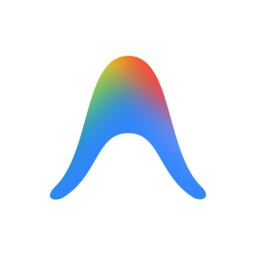
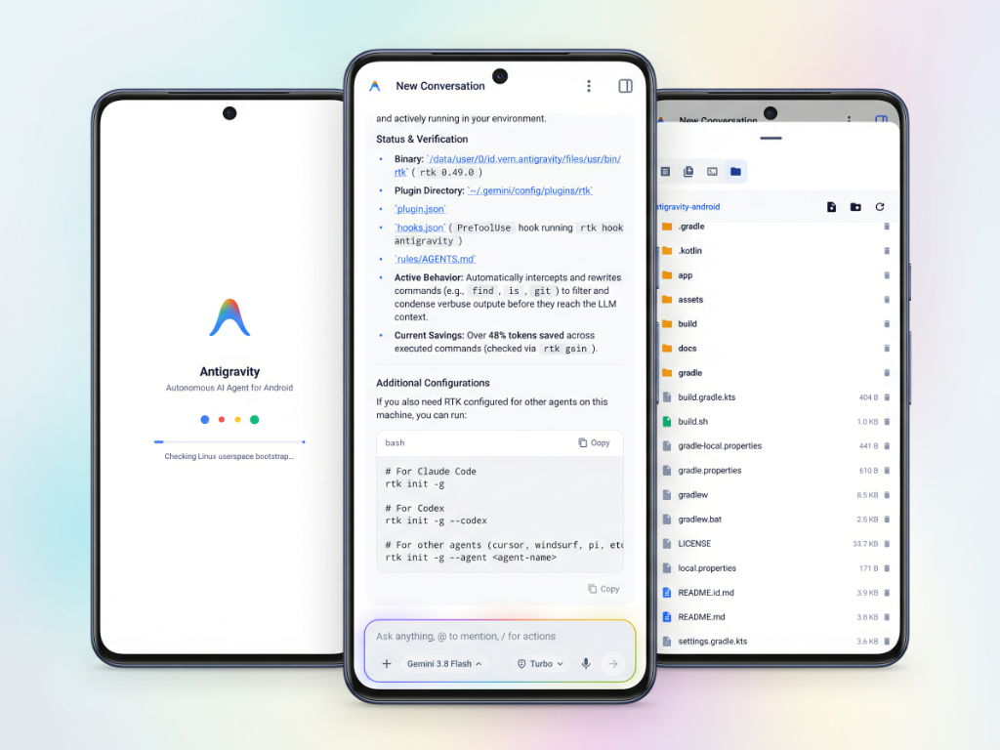

<div align="center">

  

  # Antigravity for Android

  <p align="center">
    <a href="README.md"></a>
    &nbsp;
    <a href="README.id.md"></a>
  </p>

  [](https://android.com)
  [](https://arm.com)
  [](https://developer.android.com/jetpack/compose)
  [](https://kotlinlang.org)
  [](LICENSE)

  <br /><br />

  

</div>

Antigravity for Android runs Google Antigravity AI coding agents on Android devices. It provides a standalone ARM64 Linux userspace with a native Jetpack Compose UI, enabling the agent to inspect workspace files, edit code, and run terminal commands (`git`, `bash`, `python`, `pkg`) directly on your phone without a PC.

## Features

- **Jetpack Compose UI**: Lightweight chat interface and code editor built for mobile.
- **Local Linux Userspace**: ARM64 environment with `bash`, `python3`, and CLI tools.
- **Official Agent Core**: Runs the Antigravity `language_server` daemon authenticated via Google OAuth 2.0 PKCE.
- **Package Manager (`pkg`)**: Built-in Bash/AWK package manager for installing CLI tools.
- **Background Daemon (`agy-daemon`)**: Background service handling cron tasks, file watchers, and notifications.
- **Skills & Plugins**: Fetch community skills and plugins directly from the catalogue.

## Related Repositories

- [KuatoDev/antigravity-bootstrap](https://github.com/KuatoDev/antigravity-bootstrap) — Pre-built Linux ARM64 rootfs extracted on first run.
- [KuatoDev/antigravity-catalogue](https://github.com/KuatoDev/antigravity-catalogue) — Skills and plugins catalogue. Submit a pull request here to share custom skills :)

## Building the APK

The APK is built automatically on GitHub Actions. Every push produces a fresh
artifact under **Actions → Build Antigravity APK**, and a downloadable entry in
**Releases**.

Local build:

```bash
./gradlew :app:assembleRelease
# output: app/build/outputs/apk/release/app-release.apk
```

### OAuth credentials

`OAuthManager` does not hardcode the Google OAuth client any more; it is
injected at build time from (in priority order):

| Source | Key |
| --- | --- |
| Gradle property (`~/.gradle/gradle.properties`, CLI `-P`, or `gradle-local.properties`) | `oauthClientId`, `oauthClientSecret` |
| Environment variable | `OAUTH_CLIENT_ID`, `OAUTH_CLIENT_SECRET` |

CI reads the repository secrets `OAUTH_CLIENT_ID` / `OAUTH_CLIENT_SECRET`.
Without them the app still compiles and launches, but Google sign-in will not
complete.

## Requirements

- Android 11+ (`arm64-v8a`)
- Storage & notification permissions

## Community

- **Telegram Channel**: [t.me/vernkuato](https://t.me/vernkuato)
- **Telegram Group**: [t.me/kuatodevprojects](https://t.me/kuatodevprojects)

## Donation

If you find Antigravity for Android useful and want to support its development, you can donate via:

<div align="center">

  <a href="https://saweria.co/kuatodev">
    
  </a>

  <br />

  [](https://saweria.co/kuatodev)
  &nbsp;
  [](http://paypal.me/vernkuato)

  <p><sub>Scan the QR code above or visit <strong><a href="https://saweria.co/kuatodev">Saweria</a></strong> (QRIS, GoPay, OVO, Dana) or <strong><a href="http://paypal.me/vernkuato">PayPal</a></strong>.</sub></p>

</div>

## Credits

- **[Werdik (werdio325-png)](https://github.com/werdio325-png)** — `pkg`, `agy-daemon`, and userspace scripts.
- **[Termux](https://github.com/termux)** — Android ARM64 rootfs base and `libtermux-exec`.
- **[Google DeepMind](https://deepmind.google)** — Antigravity core `language_server`.

---

<div align="center">
  <sub>Licensed under the GNU Affero General Public License v3.0 (AGPL-3.0).</sub>
</div>
